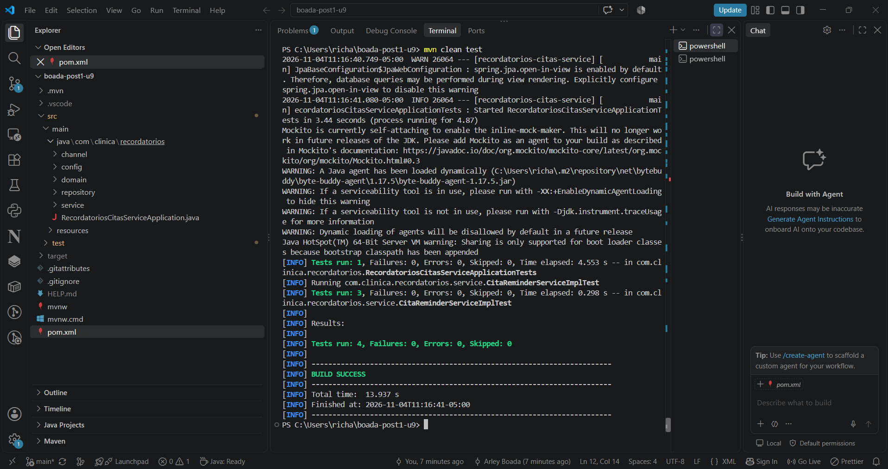
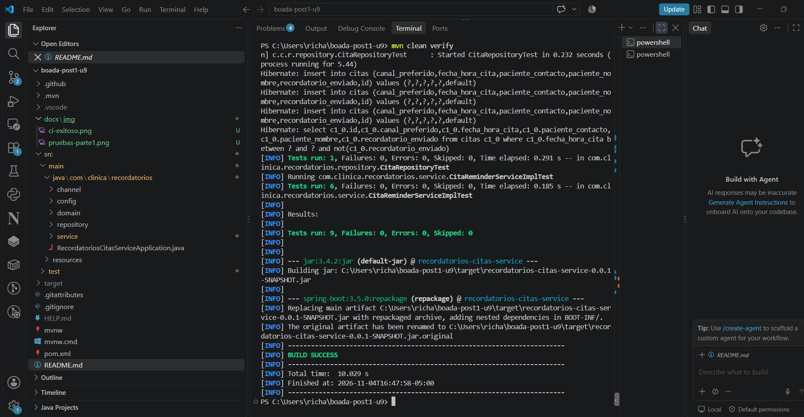
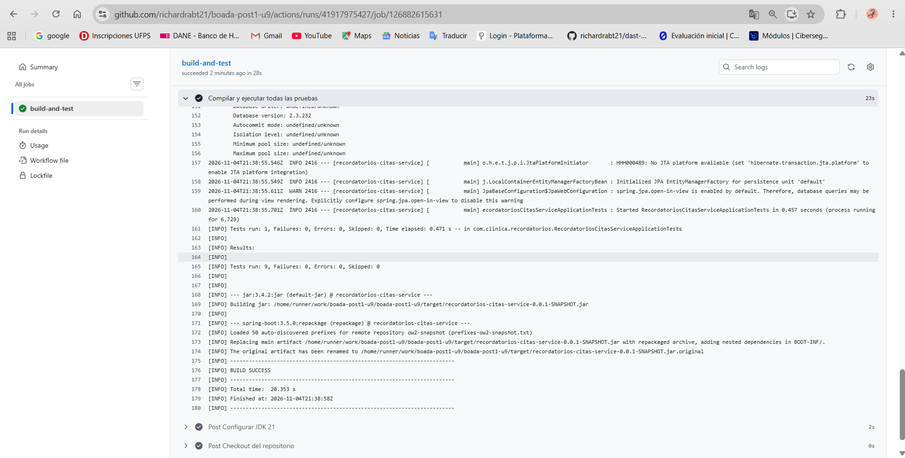

# Recordatorios Citas Service


## Descripción

Repositorio del post-contenido de la Unidad 9 de Patrones de Diseño de Software.
Un único proyecto Spring Boot que envía recordatorios de citas por el canal
preferido del paciente (correo o SMS), construido desde el inicio con Strategy
(`ReminderChannel`) y Factory Method (`ReminderChannelFactory`) inyectados por
constructor.

## Parte 1 — Pruebas unitarias con JUnit 5 y Mockito

`CitaReminderServiceImplTest` aísla `CitaReminderServiceImpl` de sus
colaboradores. Ver "Decisiones de diseño" para la justificación de por qué cada
uno se mockeó o se resolvió con un fake.



## Parte 2 — Refactor DIP, integración y CI/CD

`enviarRecordatorioUrgente` nació con un `new` hardcodeado que lo hacía imposible
de testear; el refactor lo movió a `config/CanalUrgenteConfig.java` e inyectó la
abstracción por constructor. `CitaRepositoryTest` (`@DataJpaTest`) y
`CitaReminderServiceIntegrationTest` (`@SpringBootTest`) prueban la persistencia
y el flujo completo con H2 y un `Clock` fijo. El pipeline
`.github/workflows/ci.yml` ejecuta `mvn verify` en cada push.

## Decisiones de diseño

### Mock, stub o fake para cada colaborador (Parte 1)

- **`CitaRepository` → Mock.** No basta con stubbear la consulta para que
  devuelva una lista: también hay que verificar que `save()` se llama una vez y
  con la cita marcada como enviada. Cuando una prueba necesita controlar la
  respuesta y además verificar la interacción, es un mock.
- **`ReminderChannelFactory` / `ReminderChannel` → Mock.** El comportamiento bajo
  prueba es la selección de estrategia: que el servicio pida el canal correcto
  y que ese canal reciba el mensaje. Eso solo se comprueba verificando la
  interacción, no con un valor de retorno.
- **`Clock` → Fake (no mock).** `Clock.fixed(...)` es una implementación real y
  completa que provee el JDK y se comporta igual que en producción, solo con el
  instante congelado. Mockearlo exigiría stubbear `instant()` y `getZone()` por
  separado y sería menos fiel al comportamiento real.

### Qué patrón facilitó qué prueba

- **Strategy (`ReminderChannel`).** Sin esta interfaz, la lógica de envío (SMTP o
  SMS) estaría escrita dentro del servicio, y probar la selección de canal
  exigiría mockear librerías de bajo nivel. Con Strategy, un solo
  `@Mock ReminderChannel` sirve para verificar cualquier canal con un único
  método `enviar()`.
- **Factory Method (`ReminderChannelFactory`).** Sin ella, el servicio tendría un
  `if/else` o un `switch` embebido, y esa decisión solo sería observable de
  forma indirecta. Con la Factory inyectada, la prueba de
  `usaElCanalPreferido` stubbea `obtenerCanal(EMAIL)` y comprueba que el canal
  devuelto recibe el mensaje.
- **DIP + `Clock` inyectado.** Al recibir el reloj por constructor, la prueba
  `ventanaDeterministaSegunClockFijo` puede afirmar los límites exactos de la
  ventana de 24 horas. Con `Clock.systemDefaultZone()` esa aserción cambiaría en
  cada ejecución.

### El refactor DIP (Parte 2)

Antes de tocar el código se documentó el diagnóstico: `enviarRecordatorioUrgente`
construía el canal con `new` dentro del método (línea 54 de
`CitaReminderServiceImpl`), así que no había ningún punto de sustitución. En
contraste, `enviarRecordatoriosPendientes()` ya era testeable desde la Parte 1
porque recibía sus colaboradores por constructor. Técnicamente se podría
interceptar ese `new` con `Mockito.mockConstruction()`, pero eso indica que el
problema es el diseño y no la herramienta.

**Antes** — `new` hardcodeado dentro del método (no testeable):

```java
@Override
public void enviarRecordatorioUrgente(Long citaId) {
    Cita cita = citaRepository.findById(citaId)
            .orElseThrow(() -> new CitaNoEncontradaException(citaId));

    ReminderChannel canalUrgente = new SmsReminderChannel(new TwilioNotificadorSmsGateway());
    canalUrgente.enviar(cita, "URGENTE: su cita es en menos de 2 horas y no ha sido confirmada");

    cita.setRecordatorioEnviado(true);
    citaRepository.save(cita);
}
```

**Después** — el `new` vive en el composition root y el servicio recibe la
abstracción por constructor:

```java
@Configuration
public class CanalUrgenteConfig {
    @Bean
    public ReminderChannel canalUrgente(NotificadorSmsGateway gateway) {
        return new SmsReminderChannel(gateway);
    }
}
```

```java
public CitaReminderServiceImpl(CitaRepository citaRepository,
                               ReminderChannelFactory reminderChannelFactory,
                               @Qualifier("canalUrgente") ReminderChannel canalUrgente,
                               Clock clock) { ... }

@Override
public void enviarRecordatorioUrgente(Long citaId) {
    Cita cita = citaRepository.findById(citaId)
            .orElseThrow(() -> new CitaNoEncontradaException(citaId));

    canalUrgente.enviar(cita, "URGENTE: su cita es en menos de 2 horas y no ha sido confirmada");

    cita.setRecordatorioEnviado(true);
    citaRepository.save(cita);
}
```

La prueba `enviarRecordatorioUrgente_gatewayFalla_noMarcaComoEnviado` era
imposible de escribir antes del refactor y es la evidencia de que la
testabilidad es consecuencia directa de aplicar DIP.

### Pruebas de integración: por qué H2 real pero gateway mockeado

No es inconsistente que convivan una base de datos real y un mock. H2 es un fake
aceptable porque su contrato SQL/JPA es equivalente al de la base real y no
requiere infraestructura adicional. Un proveedor de SMS de terceros no tiene un
equivalente gratuito y determinista; mockearlo evita depender de credenciales,
de la red y de la disponibilidad del proveedor en cada ejecución del pipeline.

### CI sin contenedor de base de datos

El workflow no incluye un bloque `services:` porque las pruebas de integración
usan H2 en memoria. Si se hubiera probado contra PostgreSQL con Testcontainers,
el pipeline necesitaría un runner con Docker y tiempos de arranque mayores.

## Notas de entorno

- **Spring Boot 3.5.0** en lugar de 3.3.x: Spring Initializr ya no ofrece la
  línea 3.x, y Boot 4 elimina `@MockBean`, que el enunciado exige.
- **Lombok como procesador de anotaciones**: con JDK 23, `javac` no ejecuta los
  procesadores del classpath por defecto, así que se declaró Lombok en
  `annotationProcessorPaths` del `maven-compiler-plugin`.
- **`@MockBean`** está marcado como deprecated desde Spring Boot 3.4; su
  reemplazo es `@MockitoBean`. Se mantuvo `@MockBean` por seguir el enunciado.
- **Bean de `Clock` de prueba** renombrado a `clockDeterminista` para no chocar
  con el bean `clock` de `ClockConfig`, ya que la sobrescritura de beans está
  desactivada por defecto.
- **Errata del enunciado**: el comando del workflow debe ser
  `--no-transfer-progress` (con dos guiones pegados).

## Ejecutar las pruebas

```bash
mvn test      # Pruebas unitarias
mvn verify    # Unitarias + integración
```

## Evidencia

Todas las pruebas en verde (9 en total) con `mvn clean verify`:



Pipeline de GitHub Actions ejecutado con éxito:



## Herramientas utilizadas

- Java 21, Spring Boot 3.5, Spring Data JPA, H2, JUnit 5, Mockito
- Apache Maven, GitHub Actions, Git, GitHub

## Conclusiones

Este laboratorio mostró que la facilidad para probar un servicio depende del diseño y no de la herramienta de pruebas. Strategy y Factory Method permitieron aislar `CitaReminderServiceImpl` con un solo `@Mock ReminderChannel`, y el `Clock` inyectado hizo determinista una ventana de 24 horas que de otro modo cambiaría en cada ejecución. El caso de `enviarRecordatorioUrgente` fue el más claro: con el `new` hardcodeado no había dónde sustituir el canal, y al moverlo al composition root la prueba del fallo del gateway pasó a ser posible. También aprendí a elegir el tipo de test double según lo que se quiere comprobar: mock cuando hay que verificar interacciones, y fake (`Clock.fixed`, H2) cuando existe una implementación real y fiel. Finalmente, usar H2 en memoria simplificó el pipeline de GitHub Actions, porque no necesitó un contenedor de base de datos.